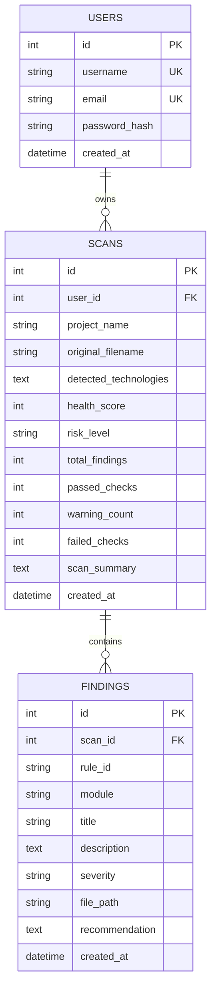

# StackDoctor Database Schema & Design

## 1. Database Overview

StackDoctor uses **MySQL 8.0** in production and Docker, with SQLAlchemy ORM handling model definitions, relationships, and queries.

---

## 2. Table Specifications

### `users` Table
Stores authenticated developer accounts.

| Column | Type | Constraints | Description |
| :--- | :--- | :--- | :--- |
| `id` | `INT` | Primary Key, Auto Increment | Unique user ID |
| `username` | `VARCHAR(80)` | Unique, Indexed, NOT NULL | Account username |
| `email` | `VARCHAR(120)` | Unique, Indexed, NOT NULL | User email address |
| `password_hash` | `VARCHAR(255)` | NOT NULL | PBKDF2-SHA256 password hash |
| `created_at` | `DATETIME` | NOT NULL | Account creation timestamp |

### `scans` Table
Stores high-level scan assessment results and metadata.

| Column | Type | Constraints | Description |
| :--- | :--- | :--- | :--- |
| `id` | `INT` | Primary Key, Auto Increment | Unique scan record ID |
| `user_id` | `INT` | Foreign Key (`users.id`), NOT NULL | Owner user ID |
| `project_name` | `VARCHAR(150)` | NOT NULL | Name of analyzed project |
| `original_filename` | `VARCHAR(255)` | NOT NULL | Name of uploaded ZIP file |
| `detected_technologies` | `TEXT` | NOT NULL | JSON list of detected ecosystems |
| `health_score` | `INT` | NOT NULL | Normalized score (0 to 100) |
| `risk_level` | `VARCHAR(50)` | NOT NULL | Healthy / Needs Review / Needs Attention |
| `total_findings` | `INT` | NOT NULL, DEFAULT 0 | Count of unique issues |
| `passed_checks` | `INT` | NOT NULL, DEFAULT 0 | Number of passed modules |
| `warning_count` | `INT` | NOT NULL, DEFAULT 0 | Number of warnings |
| `failed_checks` | `INT` | NOT NULL, DEFAULT 0 | Number of critical/high issues |
| `scan_summary` | `TEXT` | NULL | JSON module summary |
| `created_at` | `DATETIME` | NOT NULL | Scan timestamp |

### `findings` Table
Stores individual problems detected by static inspection rules.

| Column | Type | Constraints | Description |
| :--- | :--- | :--- | :--- |
| `id` | `INT` | Primary Key, Auto Increment | Unique finding ID |
| `scan_id` | `INT` | Foreign Key (`scans.id`), CASCADE | Associated scan record |
| `rule_id` | `VARCHAR(50)` | NOT NULL | Rule code (e.g. `SEC-001`, `DOC-004`) |
| `module` | `VARCHAR(80)` | NOT NULL | Analyzer module name |
| `title` | `VARCHAR(255)` | NOT NULL | Finding title |
| `description` | `TEXT` | NOT NULL | Description with masked secret values |
| `severity` | `VARCHAR(30)` | NOT NULL | Critical / High / Medium / Low / Informational |
| `file_path` | `VARCHAR(255)` | NULL | Relative path of the affected file |
| `recommendation` | `TEXT` | NULL | Suggested resolution |
| `created_at` | `DATETIME` | NOT NULL | Timestamp |
